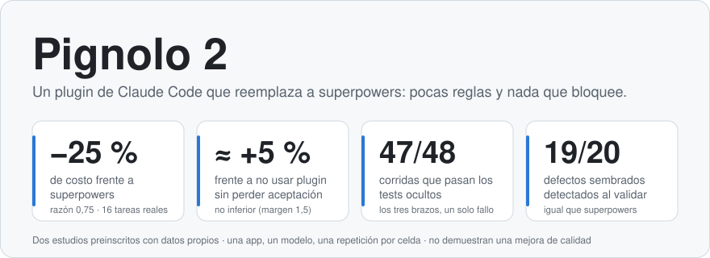
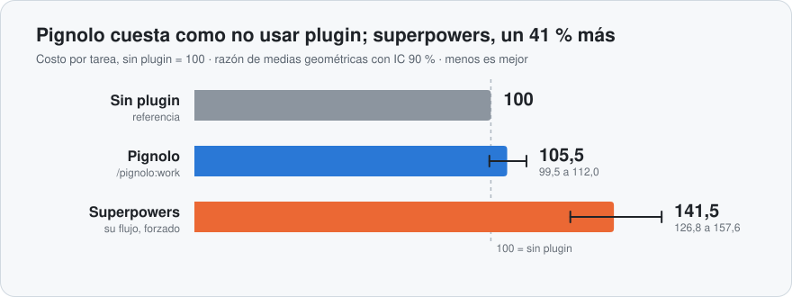
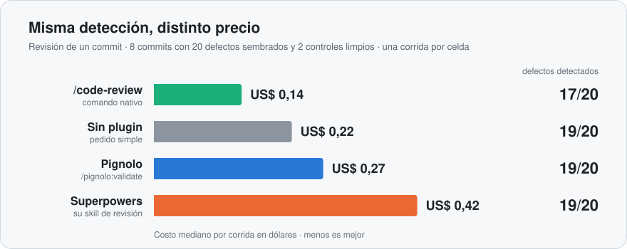

  <picture>
    <source media="(prefers-color-scheme: dark)" srcset="docs/assets/hero-dark.svg">
    
  </picture>

  <picture>
    <source media="(prefers-color-scheme: dark)" srcset="docs/assets/costo-dark.svg">
    
  </picture>

  <picture>
    <source media="(prefers-color-scheme: dark)" srcset="docs/assets/revision-dark.svg">
    
  </picture>

Datos y límites en [`RESULTS-estudio-a-trabajo.md`](tests/evals/RESULTS-estudio-a-trabajo.md) y [`RESULTS-estudio-b-revision.md`](tests/evals/RESULTS-estudio-b-revision.md); el diseño preinscrito está en [`RESULTS-comparacion-3-brazos.md`](tests/evals/RESULTS-comparacion-3-brazos.md). Los gráficos se regeneran con `node tests/evals/readme-charts.mjs`.

# Pignolo

Pignolo 2 (1.1.0) es un plugin de Claude Code que reemplaza a superpowers con una metodología más liviana: pocas reglas, cada una con su razón, y nada que bloquee. Una skill de cada cosa que se hace en un proyecto: empezar, trabajar, validar, cerrar la sesión, diseñar la interfaz y auditarla. Diseño: [`docs/specs/2026-10-23-pignolo-2-design.md`](docs/specs/2026-10-23-pignolo-2-design.md).

**Usá Pignolo 2 o superpowers, no los dos activos a la vez:** sus skills "obligatorias" compiten por activarse.

## Requisitos

- Claude Code.
- Node ≥ 22 para los scripts de `ui-audit` (sin dependencias npm); un navegador para sus mediciones (sin él, la auditoría lo dice y sigue con lo que puede).

## Instalar

Desde la terminal:

    claude plugin marketplace add Pign-a/Pignolo
    claude plugin install pignolo@pignolo

O dentro de Claude Code: `/plugin marketplace add Pign-a/Pignolo` y `/plugin install pignolo@pignolo`. Para tomar cambios nuevos: `/plugin marketplace update pignolo`.

Si tenías instalados los plugins anteriores `pignolo-ui` o `pignolo-panel`, desinstalalos desde `/plugin` antes de usar este: sus skills `define`, `new`, `improve` y `audit` compiten con `ui` y `ui-audit` por los mismos pedidos.

## Las seis skills

| Comando | Qué hace |
|---|---|
| `/pignolo:start` | Deja el proyecto listo: `CLAUDE.md`, `security.md`, `design.md` y `roadmap.md`. En un repo existente los adopta en vez de pisarlos. |
| `/pignolo:work` | Trabaja un pedido con el cuidado que pide su riesgo: piensa antes de tocar, prueba antes de afirmar y delega solo lo que es independiente. No exige documentos previos. |
| `/pignolo:validate` | Revisa lo hecho desde el último commit validado, con agentes en paralelo solo para los frentes que la evidencia pide (seguridad, base de datos, código, tests, higiene, documentación) y avisa el costo antes de lanzarlos. |
| `/pignolo:session` | Cierra la sesión: un registro por día en `docs/sessions/` con lo hecho, lo decidido y lo abierto, y el contexto de `CLAUDE.md` al día. |
| `/pignolo:ui` | Define la identidad visual y diseña cada pantalla con opciones en HTML local navegable, en `design/`; vos elegís. |
| `/pignolo:ui-audit` | Audita una pantalla con mediciones en el navegador, un catálogo de reglas y un auditor independiente; cada hallazgo cita su evidencia. Solo si se pide. |

## Qué genera en tu proyecto

- `CLAUDE.md`, `security.md`, `design.md` y `roadmap.md` en la raíz.
- `docs/sessions/`: un registro por día.
- `docs/research/`: lo que se investigó.
- `design/`: las opciones de interfaz y el registro de lo decidido (`index.html`, que se abre con doble clic).

## Tests

    npm test

Los tests de navegador de `ui-audit` necesitan `PIGNOLO_UI_BROWSER` apuntando a Chrome en las máquinas donde Edge cierra el pipe de CDP.

## Qué se midió

Comparación preinscrita contra superpowers y contra no usar plugin (mismo modelo y esfuerzo, una app privada, una repetición por celda): `work` cuesta lo mismo que no usar plugin y un 25 % menos que superpowers, con la misma aceptación; `validate` detecta tantos defectos sembrados como los otros brazos. No se demostró una mejora de calidad (ambos estudios están en el techo), `work` hace diffs algo más grandes que sin plugin, y las demás skills no se midieron. Los datos y los límites están en `tests/evals/RESULTS-estudio-a-trabajo.md` y `RESULTS-estudio-b-revision.md`.

## Versión anterior

El plugin anterior (guardia de git, carriles, panel y la interfaz como plugin aparte) quedó en la etiqueta local `legacy` y en las ramas viejas del repo. No se instala desde este marketplace.
